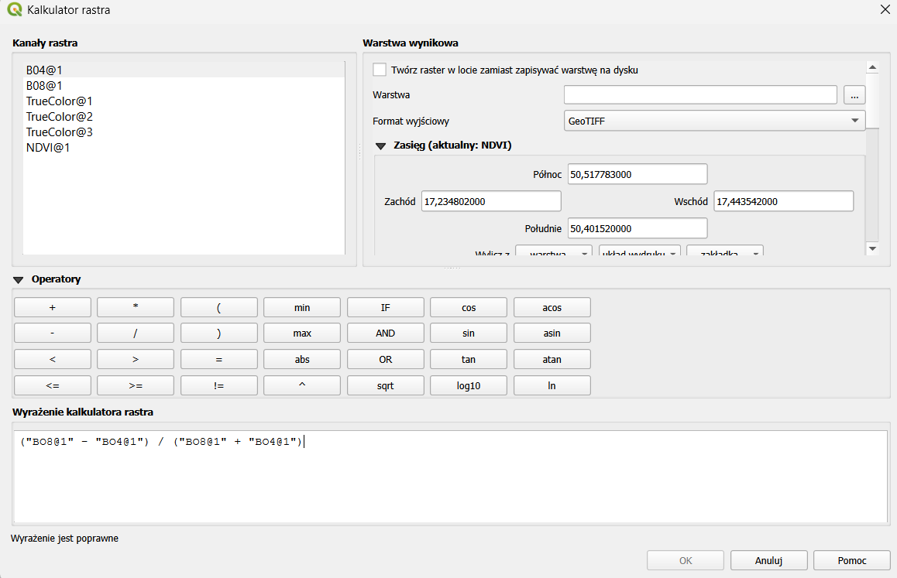
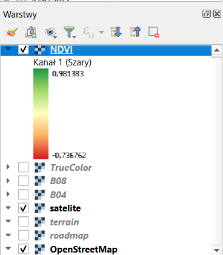
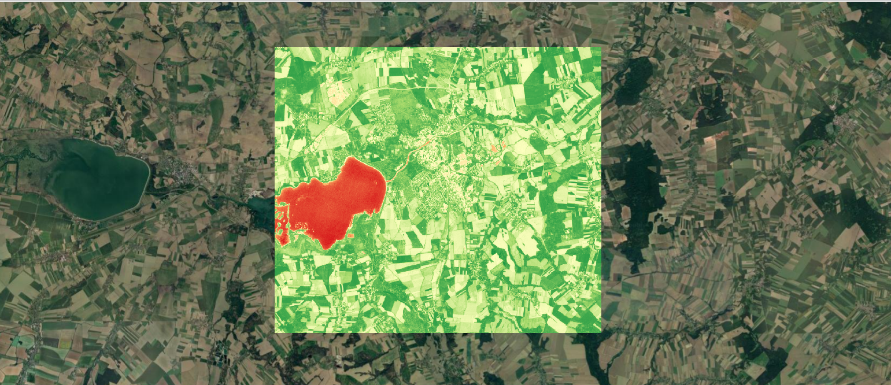

# Lab 1 Copernicus – obliczanie wskaźnika NDVI w QGIS

## Autor

| | |
|---|---|
| **Imię i nazwisko** | Dawid Parobczy |
| **Numer indeksu** | 102446 |
| **Data utworzenia** | 26.10.2026 |
| **Obszar analizy** | Nysa i okolice (woj. opolskie) |
| **Źródło danych** | Copernicus – Sentinel-2 (Copernicus Data Space Ecosystem) |

---

## Cel pracy

Celem pracy było obliczenie i wizualizacja wskaźnika wegetacyjnego **NDVI** (*Normalized Difference Vegetation Index*) dla wybranego obszaru na podstawie zobrazowań satelitarnych misji **Sentinel-2** z programu Copernicus. Zadanie obejmowało:

- pobranie kanałów spektralnych **B04 (Red)** i **B08 (NIR)** z serwisu Copernicus Browser,
- wczytanie danych do programu **QGIS** i nałożenie ich na mapę podkładową,
- obliczenie NDVI za pomocą **Kalkulatora rastra**,
- nadanie warstwie wynikowej czytelnej symbolizacji kolorystycznej,
- interpretację otrzymanej mapy – rozróżnienie terenów z roślinnością, terenów zabudowanych / odsłoniętych oraz wód.

---

## Wskaźnik NDVI – podstawy teoretyczne

NDVI wykorzystuje różnicę w odbiciu promieniowania przez roślinność w dwóch zakresach widma:

- zdrowa roślinność **silnie pochłania światło czerwone** (chlorofil wykorzystuje je w fotosyntezie),
- jednocześnie **silnie odbija bliską podczerwień** (NIR) dzięki strukturze komórkowej liści.

Wzór:

```
NDVI = (NIR − RED) / (NIR + RED)
```

Dla Sentinel-2:

| Kanał | Zakres | Długość fali (środek) | Rozdzielczość przestrzenna |
|---|---|---|---|
| **B04** | Red (czerwony) | ~665 nm | 10 m |
| **B08** | NIR (bliska podczerwień) | ~842 nm | 10 m |

Wartości NDVI mieszczą się w przedziale **⟨−1; 1⟩**. Orientacyjna interpretacja:

| Zakres NDVI | Typ pokrycia terenu |
|---|---|
| < 0 | woda, śnieg, chmury |
| 0 – 0,2 | zabudowa, drogi, odsłonięta gleba, skały |
| 0,2 – 0,5 | roślinność rzadka lub słaba (łąki, uprawy we wczesnej fazie) |
| > 0,5 | roślinność gęsta i zdrowa (lasy, bujne uprawy) |

---

## Wykorzystane narzędzia i dane

| Element | Opis |
|---|---|
| Serwis danych | [Copernicus Browser](https://browser.dataspace.copernicus.eu/) |
| Satelita | Sentinel-2 (L2A) |
| Pobrane warstwy | B04, B08, True Color |
| Format danych | TIFF (32-bit float) |
| Oprogramowanie GIS | [QGIS](https://qgis.org/) |
| Mapy podkładowe | Google Satellite, OpenStreetMap |
| Format wyniku | GeoTIFF |

Obszar obejmuje miasto Nysa wraz z fragmentem **Jeziora Nyskiego** oraz okoliczne tereny rolnicze i leśne.

---

## Przebieg pracy

### 1. Pobranie danych z Copernicus Browser

1. Zalogowanie się w serwisie [Copernicus Browser](https://browser.dataspace.copernicus.eu/) (wcześniej rejestracja konta).
2. Wybranie obszaru zainteresowania – Nysa i okolice.
3. Wyszukanie najnowszego dostępnego zobrazowania za pomocą opcji **„Show latest date”**.
4. Kliknięcie ikony pobierania i przejście do zakładki **Analytical**.
5. Ustawienie parametrów pobierania:
   - format: **TIFF (32-bit float)** – zachowuje rzeczywiste wartości odbicia, co jest niezbędne do poprawnych obliczeń,
   - rozdzielczość odpowiadająca kanałom 10 m,
   - zaznaczone warstwy: **B04**, **B08** (oraz dodatkowo **True Color** do wizualnego porównania).
6. Pobranie i rozpakowanie plików.

### 2. Przygotowanie projektu w QGIS

1. Utworzenie nowego projektu w QGIS.
2. Dodanie map podkładowych przez *XYZ Tiles* (Google Satellite, Terrain, Roadmap, OpenStreetMap) – zgodnie z [instrukcją Hatari Labs](https://hatarilabs.com/ih-en/how-to-add-a-google-map-in-qgis-3-tutorial).
3. Wczytanie warstw rastrowych B04, B08 oraz True Color.
4. Zmiana nazw warstw na krótkie i jednoznaczne (`B04`, `B08`, `TrueColor`), aby ułatwić budowanie wyrażenia w kalkulatorze.

### 3. Obliczenie NDVI – Kalkulator rastra

Z menu: **Raster → Kalkulator rastra…**

Wprowadzone wyrażenie:

```
("B08@1" - "B04@1") / ("B08@1" + "B04@1")
```

gdzie `B08@1` to kanał NIR, a `B04@1` to kanał czerwony. Wynik zapisano jako nową warstwę **NDVI** w formacie GeoTIFF.



### 4. Symbolizacja wyniku

W **Właściwościach warstwy → Symbolizacja** ustawiono:

- typ renderowania: **Jednokanałowy pseudokolor** (*Singleband pseudocolor*),
- rampa kolorów: **czerwony → żółty → zielony** (RdYlGn),
- zakres wartości odczytany automatycznie z danych.



---

## Wyniki

Warstwa NDVI nałożona na zdjęcie satelitarne:



**Zakres otrzymanych wartości NDVI:**

| Statystyka | Wartość |
|---|---|
| Minimum | −0,736762 |
| Maksimum | 0,981383 |

**Interpretacja kolorów na mapie:**

| Kolor | Wartości NDVI | Co przedstawia |
|---|---|---|
| Zielony (ciemny) | wysokie (> 0,5) | zdrowa, gęsta roślinność – lasy, zadrzewienia, łąki, uprawy ozime |
| Żółty / jasnozielony | niskie (ok. 0 – 0,3) | zabudowa miejska Nysy, drogi, odsłonięta gleba (pola po zbiorach / zaorane) |
| Czerwony | ujemne (< 0) | woda – **Jezioro Nyskie** oraz mniejsze zbiorniki |

---

## Wnioski

1. **NDVI skutecznie rozróżnia podstawowe typy pokrycia terenu.** Na mapie wyraźnie widać trzy klasy: wodę (czerwony), tereny zabudowane i odsłonięte (żółty) oraz roślinność (zielony).
2. **Woda ma wartości ujemne.** Jezioro Nyskie jest jednoznacznie wydzielone (wartości do ok. −0,74), ponieważ woda odbija więcej światła czerwonego niż podczerwieni – w przeciwieństwie do roślinności.
3. **Zabudowa miejska ma NDVI bliskie zeru.** Centrum Nysy i sieć dróg (widoczne jako jasne, żółte linie i obszary) cechują się niską wartością wskaźnika, ponieważ beton, asfalt i dachy odbijają podobnie w obu kanałach.
4. **Mozaika pól jest bardzo zróżnicowana.** Sąsiadujące działki rolne mają skrajnie różne wartości NDVI. Wynika to z pory roku (koniec października) – część pól jest po zbiorach lub zaorana (niskie NDVI, kolor żółty), a część porośnięta uprawami ozimymi lub międzyplonami (wysokie NDVI, kolor zielony). Kolor żółty nie oznacza więc wyłącznie zabudowy, lecz także odsłoniętą glebę.
5. **Lasy i zadrzewienia wzdłuż cieków osiągają najwyższe wartości** – jest to roślinność trwała, aktywna fotosyntetycznie nawet jesienią.
6. **Znaczenie formatu danych.** Pobranie kanałów jako 32-bit float pozwoliło na obliczenia na rzeczywistych wartościach odbicia; użycie 8-bitowych obrazów wizualizacyjnych dałoby wyniki zniekształcone.
7. **Zastosowania praktyczne.** NDVI może służyć do monitorowania stanu upraw, wykrywania suszy, oceny terenów zielonych w mieście czy śledzenia zmian pokrycia terenu w czasie – szczególnie przy porównaniu zobrazowań z różnych dat (np. lato vs. jesień).

---

## Struktura repozytorium

```
.
├── README.md
└── img/
    ├── ndvi_mapa.png           # mapa NDVI nałożona na podkład satelitarny
    ├── warstwy_legenda.png     # panel warstw QGIS z legendą NDVI
    └── kalkulator_rastra.png   # wyrażenie NDVI w Kalkulatorze rastra
```

---

## Źródła

- [Copernicus Browser](https://browser.dataspace.copernicus.eu/)
- [QGIS](https://qgis.org/)
- [Hatari Labs – Google Maps w QGIS 3](https://hatarilabs.com/ih-en/how-to-add-a-google-map-in-qgis-3-tutorial)
